# Bahria CMS

Bahria CMS is a student companion app for Bahria University that brings the university CMS and LMS into one cleaner, mobile-friendly experience. Instead of jumping between portals, students can log in once and view assignments, attendance, grades, lecture notes, exam seating, announcements, and profile data from a single app.

The app is built for Android (Flutter) and for the web as a Next.js progressive web app. It also includes offline caching, assignment reminders, transcript export, multi-account support, and release/update plumbing so students can keep the app current without dealing with the private source repository.

## Download

[Download the latest Android APK](https://github.com/evoziosk/bahria-cms-releases/releases/latest/download/bahria-cms.apk)

## Web App / PWA
[Web app link](https://bahria-cms.pages.dev)

## What the App Does

- Connects to Bahria University CMS and LMS in one app
- Shows assignments with deadlines, status, downloads, and submission actions
- Displays attendance, grades, calculated CGPA, and a what-if CGPA calculator
- Lets students browse and download lecture notes by course
- Shows exam seating details and admit slip PDF access when available
- Exports transcripts as PDF or shareable text
- Supports announcements and notification preferences
- Caches academic data for offline viewing
- Supports multiple student accounts on one device
- Includes optional AI-generated assignment summaries for enabled users
- Provides Android home screen widgets, background sync, and update checks

## Android App Screenshots

Screenshots use sample data.

  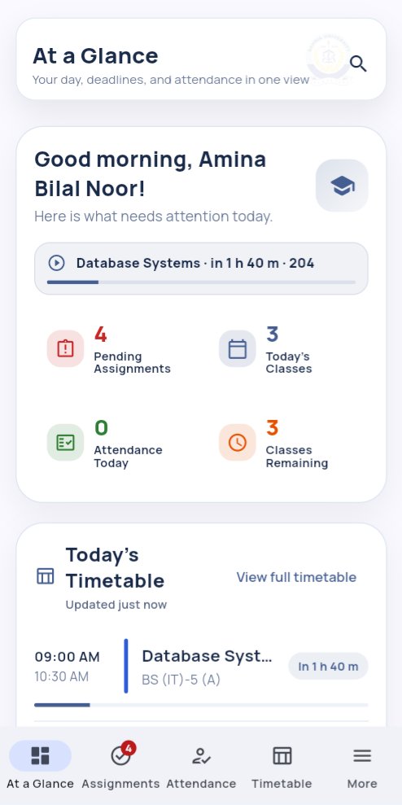
  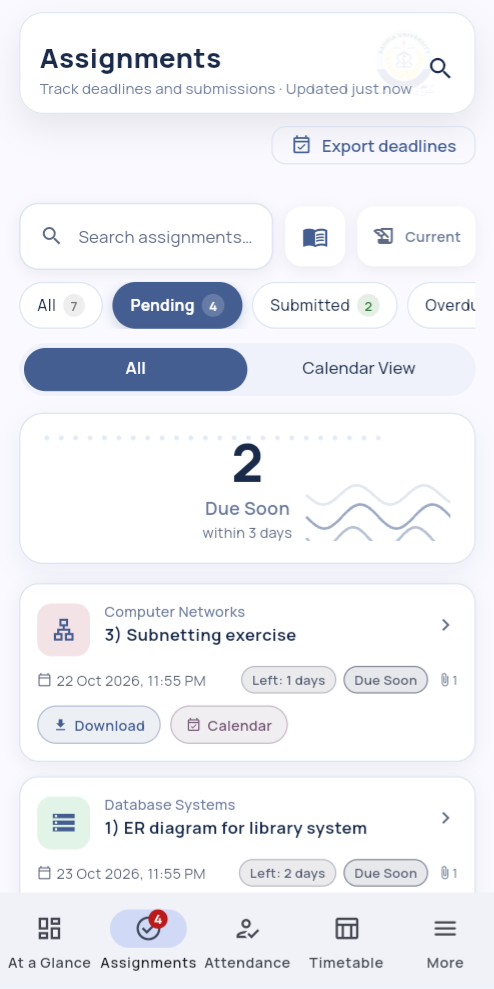
  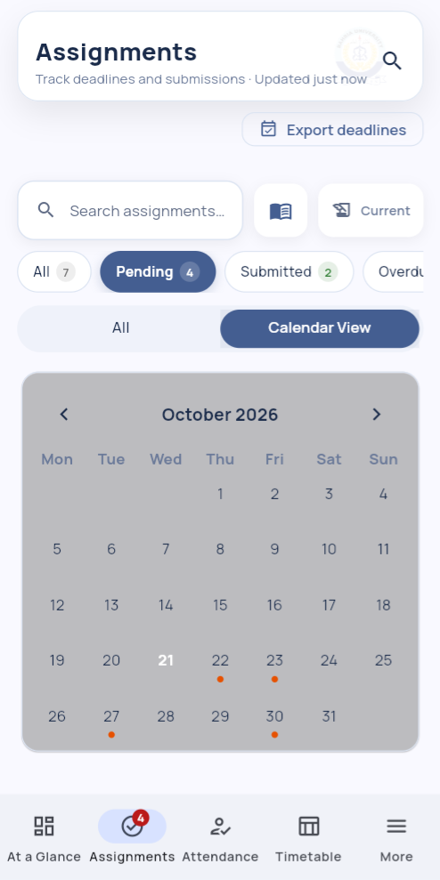
  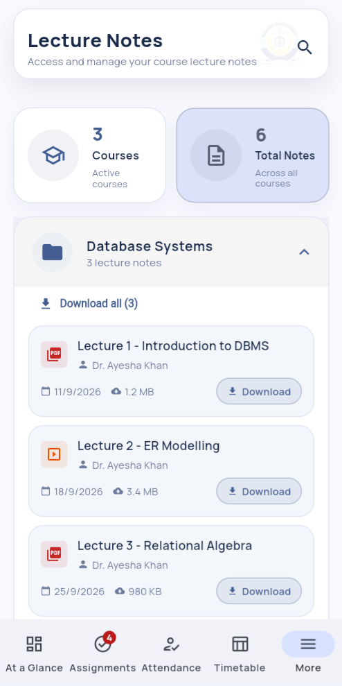

  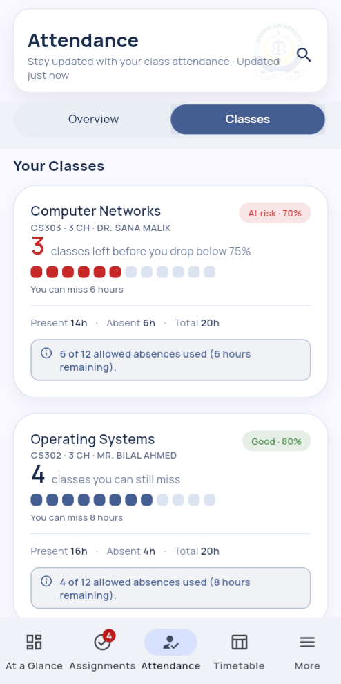
  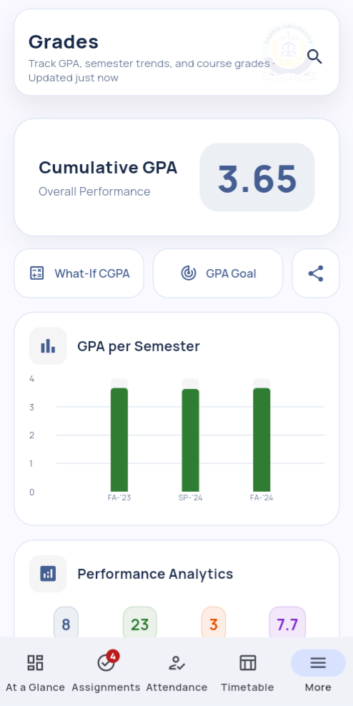
  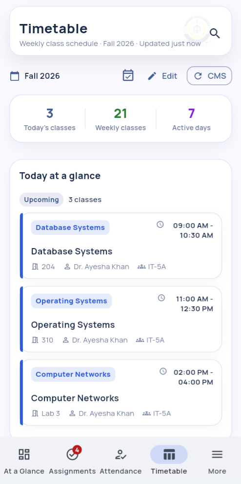

## Web App Screenshots

The web app ([bahria-cms.pages.dev](https://bahria-cms.pages.dev)) uses a frosted-glass look by default, which can be switched off in Settings. Screenshots below use sample data.

  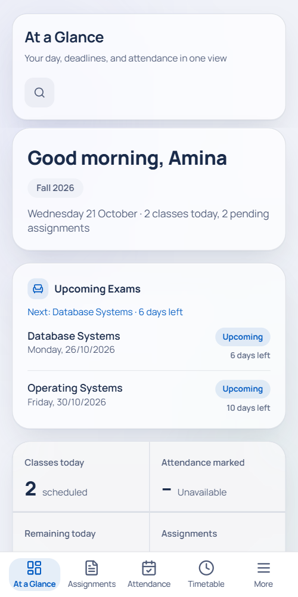
  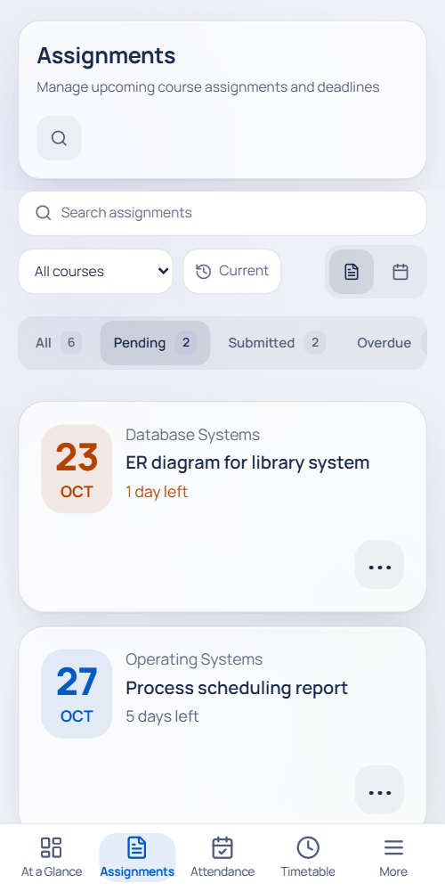
  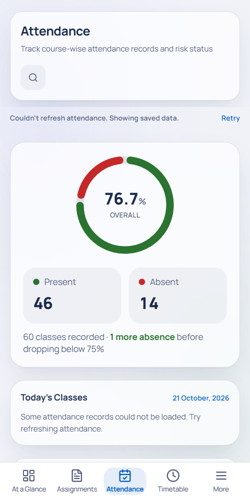

  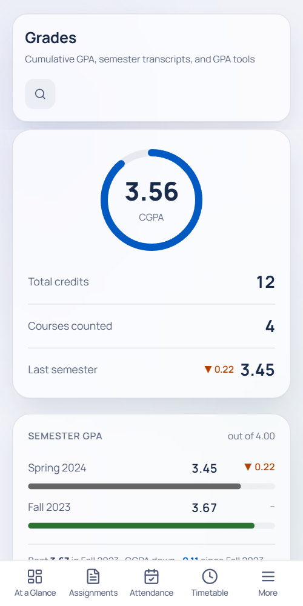
  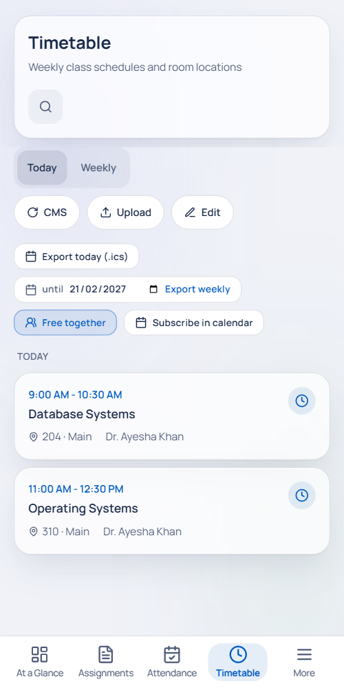

## Tech Stack

**Android app**

- Flutter and Dart
- Material 3 UI
- `http` and `html` for CMS/LMS requests and parsing
- Hive for offline caching
- Firebase Core, Firestore, Auth, and Cloud Messaging
- Workmanager for Android background sync
- Home Widget and local notifications for Android integrations

**Web app**

- Next.js (App Router, static export) with React and TypeScript
- Tailwind CSS, Radix UI primitives and Motion for the interface
- Zustand for state and IndexedDB for offline caching
- Firebase (Firestore, Auth, Cloud Messaging) and a service worker for PWA install, offline use and web push
- Cloudflare Pages for hosting

**Shared backend and tooling**

- Cloudflare Workers for CMS/LMS proxying, release metadata, and notification-related backend logic
- GitHub Actions for CI, APK builds, web deployment, and public release publishing

## Why This Exists

The official CMS and LMS flows are functional, but they are not optimized for a modern student experience across mobile devices. Bahria CMS focuses on making everyday academic tasks faster: checking deadlines, reviewing grades, downloading notes, finding exam seating, and keeping important data available even when connectivity is poor.

## Release Notes Repo Purpose

This repository is for published builds and app presentation. The source code lives in a private repository, while this public repo is used to distribute APK releases, show screenshots, and explain the product at a high level.
